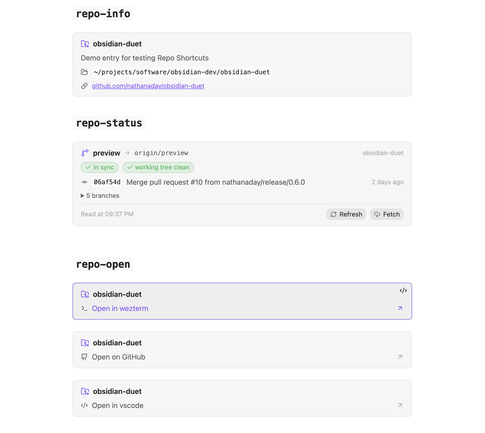

# Repo Shortcuts

<picture>
  <source media="(prefers-color-scheme: dark)" srcset="resources/dark-mode.png">
  
</picture>

## About

Many of my obsidian notes are **about** some git repository that I'm working on. However, I found myself doing a lot of tedious cross referencing:

- opening the repo in my terminal
- opening in vscode
- viewing the git status

It was enough of a hassle that I made this simple plugin. Removing the friction between your notes and the repository is great for keeping focus alive and finding that flow state. Enjoy :)


## Quickstart (For building)

### Prerequisites

- Obsidian 1.4 or later on desktop
- `git` on your machine
- Node.js 22 or later, to build the plugin

### Building

```sh
npm install
npm run build
```

The build writes `main.js` next to `manifest.json` and `styles.css`. 

Copy or symlink those three files into `<vault>/.obsidian/plugins/repo-shortcuts/`

Enable **Repo Shortcuts** under **Settings → Community plugins**.

Use `npm run dev` to rebuild on changes, and `npm test` to run the unit tests.

### Setup

Open **Settings → Repo Shortcuts**.

1. Under **Repositories**, add a repository with a name and a local path.
2. Under **Open targets**, adjust the shell commands that open a repository.

A target command may use three placeholders: `{path}`, `{name}`, and `{url}`. 

For example, `open -a iTerm {path}` adds an iTerm target.

## Usage

Each block names one repository and performs one action.

Show the name, description, path, and URL:

````markdown
```repo-info
yami
```
````

Show the branch, upstream, ahead and behind counts, working tree state, last commit, and local branches:

````markdown
```repo-status
yami
```
````

The status block reads local state when the note renders. **Refresh** reads it again, and **Fetch** runs `git fetch --prune` first, so the plugin contacts the network only when you ask.

Add a button that opens the repository in a target:

````markdown
```repo-open
repo: yami
target: wezterm
```
````

The `github` target is built in and opens the repository URL in your browser. Every other target name must match one from the settings.

## Conventions

- **One block, one repository, one action.** A note states each shortcut explicitly, so nothing depends on hidden context such as frontmatter.
- **No network access on render.** Only the **Fetch** button reaches a remote.
- **Targets are shell commands.** Supporting a new editor or terminal takes a settings entry, with no change to the plugin.

## Documentation

- Block parsing and git output parsing: `./src/core.ts`
- Git and launch commands: `./src/system.ts`
- Block rendering: `./src/blocks.ts`
- [Obsidian plugin API](https://docs.obsidian.md/Home)

## License

MIT
